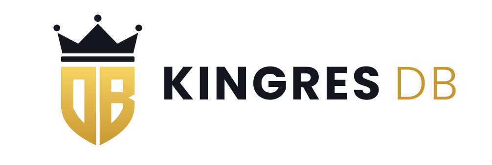

<!-- SPDX-License-Identifier: AGPL-3.0-only -->

  <picture>
    <source media="(prefers-color-scheme: dark)" srcset="brand/svg/kingres-db-horizontal-color-dark.svg">
    
  </picture>

# KingresDB

KingresDB is a thin fork of PostgreSQL that adds three things:

- **Sharding.** Tables are split into a fixed number of hash buckets spread over several servers. The logic lives in an extension (`kingres_shard`), not in the executor.
- **A tamper-evident ledger.** Ledger tables keep a hash chain and Merkle blocks, so changes to history can be detected, with digests that can be anchored outside the database (`kingres_ledger`).
- **An admin panel.** Every node serves a web panel and a REST API for creating or joining a cluster, managing databases, users, servers, rebalance and failover. The pattern follows the Couchbase cluster manager.

KingresDB is released for PostgreSQL 18 and for PostgreSQL 19 from one source: every extension builds and passes its tests on both majors ([ADR 0023](docs/adr/0023-one-extension-source-for-several-majors.md)). The control plane and the packaging have not been checked on 19 yet.

KingresDB is derived from PostgreSQL. It is not PostgreSQL, and it is not endorsed by the PostgreSQL project. The name "KingresDB" deliberately avoids the PostgreSQL marks; see the trademark section of the architecture document.

The design is in [docs/architecture.md](docs/architecture.md). It separates sourced facts, **[Recommendation]** design decisions and **[Needs verification]** items. Documents derived from it keep that distinction.

## Status

There is one product branch per PostgreSQL major, with the same KingresDB code on each: `kingres-18` on upstream tag `REL_18_7`, and `kingres-19` on `REL_19_RC2` (a pre-release until PostgreSQL 19 is released); see [docs/dev/releases.md](docs/dev/releases.md). State on 2026-11-17, by phase of the roadmap in [docs/architecture.md](docs/architecture.md):

| Phase | State |
|---|---|
| 0 Foundation, 1 Sharding MVP, 2 Distributed DML and DDL, two-phase commit, reference tables | Done (`kingres_shard` 0.2) |
| 3 Control plane, REST API, panel, package | Done; the control plane passes its integration suite on PostgreSQL 18 and on 19 |
| 4 Bucket movement and rebalancing | Built; its review ([report](docs/reviews/2026-11-16-kingresd-rebalance.md)) had two high findings about fencing; they and the other findings are fixed (a holder that lost the lease of a task writes nothing, runs no hook and raises no alert; the call that starts a move is made under a lock on the task) and the review of the fixes ([report](docs/reviews/2026-11-16-kingresd-rebalance-fixes.md)) confirmed thirteen of the fourteen and found seven more, two of them medium (a move that only waits for a lock of the extension is cancelled after 30 s and counted as a failed attempt; one refused connection to the system database during a move fails the task while the move completes); these and the causes of the failures that complete runs of the integration suite had on 2026-11-16 are fixed, and one complete run on each major passes with no failure. The review of that round ([report](docs/reviews/2026-11-17-kingresd-stabilisation-and-rebalance-second-fixes.md)) found no critical defect and two high ones (when a group stops being enforced, because its last standby is removed or `defaultReplicaCount` is set to 0, the watchdog stopped the healthy primary; a move in its switching step could be cancelled when the session that watches it died); they and the eight other findings are fixed, and these fixes have not been reviewed again. What is built: `kingres_shard` moves buckets, and the control plane drives a rebalance (a plan by bucket count, one move at a time, stop and start again, taken over after a restart or a leader change, a report per run) with its page in the panel. Several moves at once, the strategy by disk size and draining a server are phase 10 |
| 5 High availability | In progress: heartbeats, leases, standbys and the client entry point are in the control plane; `kingres_shard` 0.5 has standby nodes, `promote_node`, prepared transactions across a failover, distributed deadlock detection and coordinated restore points; of failover itself (the control plane promoting a standby) the first form exists, a failover that an operator starts by hand, and it has not been reviewed; automatic failover and switchover are not built. The independent review of 0.5 found one critical and six high defects in these functions ([report](docs/reviews/2026-11-15-kingres-shard-0.5.md)); they were fixed, each with a test. The review of those fixes ([report](docs/reviews/2026-11-16-kingres-shard-0.5-fixes.md)) found one high defect (a participant whose wait for its own synchronous standby is cancelled still answers that it prepared and committed, so after a failover of that participant its part of a committed transaction can be gone) and three medium ones in `promote_node` and the majority rule; they are fixed, each with a test, and the call sequences for a control plane are written out in the README of the extension. The review of these fixes and of the sequences ([report](docs/reviews/2026-11-16-kingres-shard-0.5-sequences.md)) found one critical defect (when a second phase was not confirmed and the participant fails over after the retention time, its part of a committed transaction is rolled back with no record), two high ones (the majority rule of the map group can be bypassed; an interrupted rotation of the secret strands a node) and gaps in four of the nine sequences; these are fixed, each with a test, and every answer of a sequence is now named in the README of the extension with the test that produces it. The review of these fixes ([report](docs/reviews/2026-11-16-kingres-shard-0.5-second-sequences.md)) found one critical defect in the proof of a planned switchover, which is fixed with a new proof (the new primary replayed the shutdown checkpoint of the old one as its last record) and a deadline on every call of a control plane. The review of that round ([report](docs/reviews/2026-11-17-kingres-shard-0.5-third-sequences.md)) found two critical and two high defects, the worst of them introduced by the round itself: **after a control call in a transaction, a later statement to a node that does not answer in time is dropped with a warning and the transaction still commits** (S11-01). They are fixed, each with a test (two only in part: the bound on the time of a whole call is per node, and the proof of a switchover still relies on duties of its caller that the README lists). The review of these fixes ([report](docs/reviews/2026-11-17-kingres-shard-0.5-fourth-sequences.md)) confirmed them and found one high defect that the round introduced: **`remove_node`, `add_node`, `rotate_secret` and `sync_catalog` can return success with no warning although a node that went silent at the very end of the call did not get its part**; also that the new time budget ends a call against a healthy node that answers slowly. This is fixed; the review of the fix ([report](docs/reviews/2026-11-18-kingres-shard-0.5-fifth-sequences.md)) found one high defect (`RELEASE SAVEPOINT` after one of these calls inside a subtransaction waited without a bound), which is fixed. The review of that fix ([report](docs/reviews/2026-11-18-kingres-shard-0.5-sixth-sequences.md)) confirmed it at every position it swept on both majors and found one high defect that is still open: **when the connection to a node breaks while a transaction is inside two nested subtransactions (two savepoints, or two nested PL/pgSQL blocks with an EXCEPTION clause), the rollback raises an error inside an abort callback and the server restarts**; also that the new limit for a whole call, `kingres_shard.control_call_timeout`, does not bound every wait of a call, and a leak of memory per failed `RELEASE`. Their fix is being written. The implementation of failover and switchover in the control plane is designed ([docs/design/ha-phase5-part2.md](docs/design/ha-phase5-part2.md)) in ten increments. The first three are built (standbys in the catalog of the extension, leases and instances per group so that a server can hold the primary of more than one group, lease transfer and the read calls); their review ([report](docs/reviews/2026-11-17-kingresd-failover-increments-0-2.md)) is incomplete by its own statement and found five high defects; they are fixed, and the review of the fixes ([report](docs/reviews/2026-11-18-kingresd-failover-fixes.md)) found seventeen more, one of them high (the list of a frozen group changes when a standby is added), most of which are fixed (five of the lower ones are open). The fourth increment is built: an operator starts a failover of a server by hand, with a dry run that shows the plan and an explicit decision when writes may be lost; it passes on both majors for a group that is not the map group. Its review ([report](docs/reviews/2026-11-18-kingresd-failover-increment-3.md)) saw no second writable primary and no lost acknowledged row on a cluster, on a dead and on a live old primary, and found by reading four high defects, each behind a second condition (**a task that fails after the promotion can release the lease of the promoted primary when the leader's own server is the new primary; an old primary that never learned it has a standby is not stopped by its lapsed lease; the verdict can say that no writes were lost for a time in which the leader did not see the primary; a database created during a failover fails the task after the promotion**), and eight medium ones, among them that the entry point of the failed-over server resets every connection afterwards. They are open. The return of the old primary as a standby, the map group, automatic failover, switchover and the pages of the console are the increments that follow. A failover must not be relied on before these are built and reviewed |
| 6 Ledger | Done (`kingres_ledger` 0.2, the verifier, the Ledger page) |
| 2b | In progress ([docs/design/shard-phase2b.md](docs/design/shard-phase2b.md)): the first two of thirteen steps are built (one bucket lookup, the compatibility definitions and the test harness; the check that tables are placed together, pruning of shard groups, the part of a query that runs on the coordinator itself). Their review ([report](docs/reviews/2026-11-18-kingres-shard-phase2b-steps-1-2.md)) compared about 22 000 generated statements with a single node on both majors and found no wrong answer and no crash; it found one high defect (**the mark of the part that runs on the coordinator can be read by SQL code that the statement itself runs, and with it a role that is not a superuser plans nested statements without routing**), three medium ones (two kinds of read that a single node answers are refused with the advice to repeat them; memory that grows with every rescan of a pruned scan) and tests that cannot fail; these are being fixed together with steps 3 and 4. A multi-shard query is still answered by the scan that moves rows |
| 9 to 12 | Designed, not implemented, except the three standalone extensions of phase 12 listed below |
| 7 Signing, anchoring, publication, aggregate digest | Designed ([docs/design/ledger-phase7.md](docs/design/ledger-phase7.md)); of 25 steps the first two are built: the verifier checks signed checkpoints, tile logs and consistency proofs, and `kingres_ledger` 0.3 has the functions from which the chain is published. Both were reviewed twice ([first](docs/reviews/2026-11-16-ledger-phase7-steps-1-2.md), [second](docs/reviews/2026-11-16-ledger-phase7-steps-1-2-fixes.md)); no input was found that makes the verifier accept a rewritten history, and the findings (a stored checkpoint that could be walked onto a fork, text of a publisher reaching the output raw, a named pipe that hung the verifier, and others) are fixed; a third review ([report](docs/reviews/2026-11-17-ledger-phase7-steps-1-2-second-fixes.md)) found one critical defect (a member of `pg_write_all_data` could insert into the ledger tables, a valid successor block included) and bounds missing in the verifier. They are fixed: the ledger tables are written by the code of the extension and by nothing else, and a database whose SQL is older than the installed library must run `ALTER EXTENSION kingres_ledger UPDATE` before its ledger is written again (its applications keep working). A fourth review ([report](docs/reviews/2026-11-17-ledger-phase7-steps-1-2-third-fixes.md)) found that the guard held against every role without inherited privileges of the owner of the extension, and one high defect: **a role that is a member of the owner of the extension, or an owner that lost SUPERUSER, can call the internal write function and write a block**; also six medium ones (a publisher without a key can make a stored state of the verifier unusable; the check of the private state directory looks at one directory only; a weak lock stops the block builder; honest proofs of old rows are refused for their size). They are fixed in the extension (no function that SQL can call takes the content of a write any more) and in the verifier (a stored state holds only what was verified; a proof has no size limit; the whole path of the state must be private); the fixes of the verifier have not been reviewed again. A fifth review, of the extension ([report](docs/reviews/2026-11-17-kingres-ledger-0.3-guard-second-review.md)), found that the rule for writes held and two high defects in what a role can stop or remove: **a member of `pg_maintain` or `pg_write_all_data` can stop the ledger with `LOCK TABLE` on a view over a ledger table, and a member of the role that owns the extension can drop it through `DROP EXTENSION plpgsql CASCADE`**; they are fixed. Two more reviews of the guard ([third](docs/reviews/2026-11-17-kingres-ledger-0.3-guard-third-review.md), [fourth](docs/reviews/2026-11-17-kingres-ledger-0.3-guard-fourth-review.md)) found that a moved sequence stopped the writers, that a lock of the ledger could be held without a bound (also by a prepared transaction), and that the README claimed too much: **a database can be dropped with its ledger by every role that has the privileges of its owner or can `SET ROLE` to it, and nothing inside the database prevents that**; these are fixed or stated (`ledger_status` lists such roles), and the last fixes have not been reviewed again. Three more reviews of the verifier ([one](docs/reviews/2026-11-17-kingres-verifier-fourth-fixes.md), [two](docs/reviews/2026-11-17-kingres-verifier-fifth-fixes.md), [three](docs/reviews/2026-11-18-kingres-verifier-sixth-fixes.md)) found no input that makes it report something it did not verify; their findings about the stored state (which signature lines it keeps, what a revoked key means for a held checkpoint, the lock and the replacement of the file) are fixed; after an eighth review ([report](docs/reviews/2026-11-18-kingres-verifier-seventh-fixes.md)) and its fixes the reviews of the verifier were ended on the reviewer's advice. Two more reviews of the guard of the ledger ([fifth](docs/reviews/2026-11-18-kingres-ledger-0.3-guard-fifth-review.md), [sixth](docs/reviews/2026-11-18-kingres-ledger-0.3-guard-sixth-review.md)) found that a role that is not a superuser could still keep a lock of the ledger without a bound through subtransactions; since then such a role may call a lock-taking function of the ledger only as a statement of its own, and that fix has not been reviewed yet. Of the later steps, library packages are written and not yet used by `kingresd`: the keys and the logs (an encrypted key file, the Merkle tree in tiles, signed checkpoints, proofs), reviewed three times (the [third](docs/reviews/2026-11-18-kingresd-key-and-log-libraries-third.md) judged them fit to be wired in), and anchoring (WORM object stores, RFC 3161, OpenTimestamps), reviewed five times (the [fifth](docs/reviews/2026-11-18-kingresd-anchoring-libraries-fifth.md) is the last): the first found that a record was called anchored on the word of a calendar, the second that a retry defeated the bound on the time of a store; the findings of all rounds are fixed, the last round of each library is not reviewed again and is covered by the review of the wiring into `kingresd`, which has begun with the contract (revision 0.11.0) and the handling of the signing keys (creation, rotation, retirement, revocation, distribution to the servers that may sign, the trust file), with the first pages of the Ledger console for them. The review of the keys ([report](docs/reviews/2026-11-18-kingresd-ledger-signing-keys.md)) found no way for a secret to reach a log, an answer or a stored row and nothing critical or high, and five medium defects that are being fixed before checkpoints are signed (a key can be retired with a bound below a checkpoint it signed; a key file that cannot be opened raises no alarm; a server that was removed is never forgotten as a holder; the clock is compared with a clock of the same host; the stored events are not verified at load); it could not run the tests that need PostgreSQL, which the integrator ran. Nothing is signed or published yet. Client signatures are built in `kingres_ledger` 0.3 (a client registers a public key and signs what it writes; a table can require it). Their first review, with the seventh of the guard ([report](docs/reviews/2026-11-18-kingres-ledger-0.3-guard-seventh-and-client-signatures.md)), found that the guard holds in every form it tried on both majors and needs no further review of its own, and that client signatures are **not ready**: a transaction that is open when a table is switched to "signature required" can commit entries without a signature afterwards, some of which `ledger_verify` cannot see (critical); a degenerate public key can be registered, and anyone who may call `ledger_attest` then forges signatures under it (high); a healthy database can be reported as damaged after a switch (medium). These are fixed, each with a test (a switch now waits for the open writers of the table, and only a canonical key of large order is registered); the fixes have not been reviewed yet, so do not rely on the policy "required" before that review. The verifier does not check client signatures yet |
| 8 | Future roadmap: not part of the first release |

For what has been done, how it was verified and what is still open, read the work log: [docs/worklog.md](docs/worklog.md).

## Repository map

The repository root is the PostgreSQL source tree (the fork). KingresDB's own code is in two places: its extensions under `contrib/`, and the top-level `kingres/` directory.

| Path | Contents |
|---|---|
| `contrib/kingres_shard/` | Sharding extension (C): catalog, bucket mapping, planner and executor hooks, two-phase commit, background worker, bucket movement. |
| `contrib/kingres_ledger/` | Ledger extension (C): ledger tables, block builder, digest and verify functions. |
| `contrib/kingres_columnar/` | Columnar storage (C): a table access method that stores a table column-wise with compression for analytic scans (phase 12; first version: insert-only, no indexes, serial scan). **Not for data that matters yet:** the independent review of 0.1 found five cases of a wrong answer or wrong committed data ([report](docs/reviews/2026-11-15-kingres-columnar-0.1.md)); they are fixed, each with a test, and the on-disk format changed with the fixes. A second review ([report](docs/reviews/2026-11-15-kingres-columnar-0.1-fixes.md)) confirmed those fixes and found one more critical defect (under SERIALIZABLE a write that a concurrent reader cannot see is not detected as a conflict) and a memory leak with many subtransactions; they were fixed with the other findings of that review except two notes. A third review ([report](docs/reviews/2026-11-16-kingres-columnar-0.1-second-fixes.md)) found that the SERIALIZABLE fix did not hold for rows flushed inside a subtransaction (critical) and two high defects in the write buffers; they were fixed, each with a test. A fourth review ([report](docs/reviews/2026-11-16-kingres-columnar-0.1-third-fixes.md)) confirmed those fixes and their tests and found two more critical defects (when memory runs out while a subtransaction is committed, rows of the aborted subtransaction can be committed; a REPEATABLE READ or SERIALIZABLE transaction that compacts a table then reads rows committed after its snapshot); they were fixed, each with a test. A fifth review ([report](docs/reviews/2026-11-16-kingres-columnar-0.1-fourth-fixes.md)) confirmed those fixes and was the first without a critical finding: one high (a table converted from heap could show an older snapshot an empty table instead of an error), one medium and four low; they are fixed, each with a test. A sixth review ([report](docs/reviews/2026-11-17-kingres-columnar-0.1-fifth-fixes.md)) found no critical defect, one high (rows written by code of another extension inside the commit could be lost or doubled), two medium and three low; they are fixed, each with a test. A seventh review ([report](docs/reviews/2026-11-17-kingres-columnar-0.1-sixth-fixes.md)) found no wrong answer and no lost row, and one high defect (**a write that reaches the table while its transaction is ending, from a commit callback of another module, stops the server**), one medium and four low. They are fixed, each with a test: such a write is refused with a warning and the server goes on; at some of those moments a heap table would have kept the row, which the README of the extension states. Four more reviews followed ([eighth](docs/reviews/2026-11-17-kingres-columnar-0.1-seventh-fixes.md), [ninth](docs/reviews/2026-11-17-kingres-columnar-0.1-eighth-fixes.md), [tenth](docs/reviews/2026-11-18-kingres-columnar-0.1-ninth-fixes.md), [eleventh](docs/reviews/2026-11-18-kingres-columnar-0.1-tenth-fixes.md)); their findings up to the tenth are fixed. The last two found no wrong answer, no lost or doubled row and no unreadable table in ordinary use on either major, through crash recovery, a promoted standby, backup and restore. The eleventh found one high defect (if a superuser created a second access method over the handler of the extension, a routine `VACUUM` deleted every row of the tables that used it) and that the check function `columnar_check_clean()` was not fit for a monitor (false alarms while tables were dropped or rewritten; a failure with more columnar tables than the lock table holds); these are fixed, each with a test. The twelfth review ([report](docs/reviews/2026-11-18-kingres-columnar-0.1-eleventh-fixes.md)) confirmed the fixes, found no critical and no high defect and no sequence in which the clean-up deletes rows of a live table, and found four medium ones: the check says "clean" while its orphan step could not run, the memory of the check grows with the square of the number of locked tables, and two cases that need a superuser's deliberate act (an access method over a second SQL function escapes the refusal of foreign keys, triggers and publications; a module that copies the routine gets a table that drops its rows at commit). They are fixed, each with a test; the reviewer's judgement is that the extension is fit for data that matters within what it claims, and that the track can be closed after a short check of these fixes, which is owed. |
| `contrib/kingres_sketch/` | Approximate aggregates (C): distinct count, top-n and percentiles, with partial aggregation (phase 12; works on one node, pushdown across shard groups comes with phase 2b). The memory of aggregate states of a backend is bounded by a ceiling that only a superuser sets and a limit of the role's own; five reviews, the last ([report](docs/reviews/2026-11-16-phase12-extensions-fourth-fixes.md)) with one low finding, which is open. |
| `contrib/kingres_timepart/` | Time partitioning (SQL and PL/pgSQL): partitions created ahead of time and retention by policy, for ordinary tables (phase 12; distributed tables and the scheduler in the control plane come later). A superuser's session does not run the maintenance for a table of another role unless a setting says that table owners are trusted; an owner drives its own tables. A policy acts only when the interface sealed it, so a row restored from a dump does nothing until a superuser adopts it. Five reviews (the same reports as `kingres_sketch`); the last one did not cover the seal and the owner-driven path in depth. |
| `kingres/api/` | The OpenAPI contract (`openapi.yaml`). The REST API and the web client are generated from or checked against it. |
| `kingres/control-plane/` | Go code: `kingresd` (agent, manager, client router, REST API), `kingres-cli`. |
| `kingres/web/` | The admin panel: Vue 3 and TypeScript single-page application. |
| `kingres/verifier/` | Standalone command-line verifier for ledger digests and proofs. It does not trust the database. |
| `kingres/packaging/` | The single `kingres` package: `.deb`, `.rpm`, Docker image, systemd unit. |
| `kingres/dev/` | Developer scripts. |
| `kingres/docs/` | All KingresDB documentation. |
| everything else | Upstream PostgreSQL, changed only through the documented core patches. |

The full tree and the rule for where new code goes are in [docs/dev/repository-layout.md](docs/dev/repository-layout.md).

## Documents

Start here:

- [docs/architecture.md](docs/architecture.md) - design, evidence and open decisions.
- [docs/dev/getting-started.md](docs/dev/getting-started.md) - set up a development machine and build.
- [docs/worklog.md](docs/worklog.md) - dated record of work done.

Developer standards:

- [docs/dev/coding-standards.md](docs/dev/coding-standards.md) - standards per language, with the enforcing tool.
- [docs/dev/repository-layout.md](docs/dev/repository-layout.md) - directory tree and placement rules.
- [docs/dev/core-patches.md](docs/dev/core-patches.md) - register of changes to upstream files.
- [docs/dev/upstream-sync.md](docs/dev/upstream-sync.md) - branches, rebasing, new major versions.
- [docs/dev/releases.md](docs/dev/releases.md) - one release per PostgreSQL major: the product branches, how a change reaches each, what a release consists of.
- [docs/dev/testing.md](docs/dev/testing.md) - test strategy and the definition of done.
- [docs/dev/documentation.md](docs/dev/documentation.md) - what is documented where.

Decisions:

- [docs/adr/README.md](docs/adr/README.md) - index of architecture decision records and how to add one.

## License

KingresDB's own code (everything under `kingres/` and `contrib/kingres_*`) is released under the GNU Affero General Public License, version 3 (`AGPL-3.0-only`); the text is in [LICENSE](LICENSE) and at the top of the repository. PostgreSQL's code stays under the PostgreSQL License: the upstream `COPYRIGHT` file is kept unchanged. [COPYRIGHT](COPYRIGHT) says which licence covers which part, and [ADR 0024](docs/adr/0024-agpl-for-kingresdb-code.md) records the decision. See [docs/dev/coding-standards.md](docs/dev/coding-standards.md) for the file header convention.
